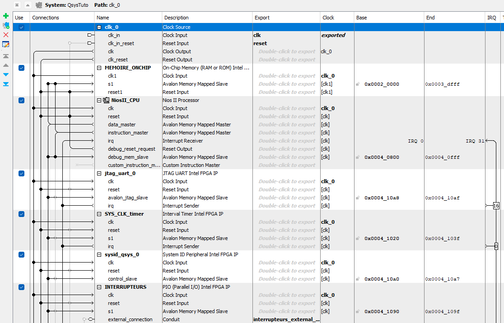

# ⏰ Projet M1 : Système Embarqué SoPC Nios II - Réveil Électronique Intelligent

Développement complet d'un système monopuce programmable (**SoPC - System on a Programmable Chip**) sur FPGA **Intel Altera MAX 10** (carte **Terasic DE10-Lite**), articulé autour d'un microprocesseur soft-core **Nios II** et de périphériques sur bus **Avalon-MM**.

---

## 🎯 Fonctionnalités du Réveil
- **Horloge temps réel :** Comptage et affichage dynamique des heures, minutes et secondes cadencé par un timer d'interruption système (1 Hz).
- **Format d'affichage commutable :** Bascule entre affichage standard **24h** et affichage **12h (AM/PM)** via un commutateur.
- **Réglage interactif :** Incrémentation et décrémentation des heures et minutes via les boutons-poussoirs de la carte.
- **Gestion des alarmes :** Programmation d'une heure de réveil personnalisée avec indicateur visuel.
- **Synthèse sonore & Mélodies :** Génération de 3 mélodies différentes sur le buzzer piézoélectrique via un timer matériel Avalon modulant les fréquences acoustiques.
- **Retour visuel :** Afficheurs 7 segments hexadécimaux multiplexés (`HEX0` à `HEX5`) et clignotement d'alerte sur la rampe de LEDs.

---

## 🏗️ Architecture Matérielle (Qsys / Platform Designer)

Le microprocesseur 32-bits **Nios II** communique à 50 MHz avec l'ensemble des contrôleurs matériels via l'interconnexion **Avalon Memory-Mapped (Avalon-MM)** :

### Mapping des Périphériques Avalon (`system.h`)

| Périphérique | Type de contrôleur | Rôle matériel |
| :--- | :--- | :--- |
| **`SYS_CLK_TIMER`** | `altera_avalon_timer` | Génération de l'interruption périodique d'une seconde (cadence horloge) |
| **`TIMER_CONTINU`** | `altera_avalon_timer` | Modulation de fréquence pour jouer les notes musicales sur le buzzer |
| **`HEX3_HEX0`** | `altera_avalon_pio` | Commande des 4 afficheurs 7 segments des minutes et secondes |
| **`HEXA1_HEXA0`**| `altera_avalon_pio` | Commande des 2 afficheurs 7 segments des heures |
| **`INTERRUPTEURS`**| `altera_avalon_pio` | Lecture de l'état des commutateurs `SW0` à `SW9` (modes, réglages) |
| **`BOUTON_POUSSOIRS`**| `altera_avalon_pio`| Lecture des boutons `KEY0` et `KEY1` pour la validation et l'incrémentation |
| **`LEDR`** | `altera_avalon_pio` | Pilotage de la rampe de 10 LEDs (témoins d'alarme et clignotement) |
| **`BUZZER`** | `altera_avalon_pio` | Signal de commande du buzzer piézoélectrique |

---

## 🧩 Brochage Matériel (Carte Terasic DE10-Lite - Intel MAX 10 `10M50DAF484C6GES`)

Le fichier de contraintes [`hardware/TD_SNE.qsf`](./hardware/TD_SNE.qsf) définit les connexions physiques :
- **Horloge système :** `PIN_P11` (50 MHz).
- **Afficheurs 7 segments :** `HEX0` à `HEX5` connectés aux bancs de broches dédiés.
- **Boutons :** `KEY0` (`PIN_B8`) et `KEY1` (`PIN_A7`).
- **Commutateurs :** `SW0` (`PIN_C10`) à `SW9` (`PIN_F15`).
- **LEDs :** `LEDR[0]` à `LEDR[9]`.

---

## 📂 Contenu du Répertoire

- **`src/` :** Logiciel embarqué en C
  - `reveil_intelligent_de10_lite.c` : Programme complet avec algorithme d'horloge, gestion d'I/O et synthétiseur de mélodies sur buzzer.
  - `reveil_code_complet.c` : Version modulaire avec fonctions d'affichage hexadécimal et gestion de timers.
- **`hardware/` :** Fichiers de synthèse matérielle Intel Quartus Prime & Qsys
  - `TD_SNE.qpf` : Fichier projet Quartus Prime.
  - `TD_SNE.qsf` : Assignation des broches physiques et paramètres technologiques.
  - `TD_SNE.bdf` : Schéma de câblage bloc d'interconnexion Top-Level.
  - `QsysTuto.qsys` : Définition du processeur Nios II, bus Avalon, mémoires et IPs Avalon.
  - `TD_SNE.sof` : Bitstream de programmation FPGA prêt à être téléversé via JTAG.
  - `TD_SNE.pin` : Rapport officiel de brochage généré par le Fitter.
- **`img/` :** Captures d'écrans du système
  - `plat1.png` & `plat2.png` : Architecture détaillée sous Intel Platform Designer (Qsys).
  - `bsf.png` : Schéma bloc du composant SoPC instancié.
- **`docs/` :**
  - `Rapport_Reveil_FPGA_DE10_Lite.pdf` : Rapport technique officiel du projet (16 pages) détaillant le cahier des charges, l'architecture Qsys, la programmation HAL Altera et les résultats d'essais.

---

## 🚀 Mise en Œuvre & Reproduction

1. **Chargement matériel (FPGA) :**
   - Ouvrir `hardware/TD_SNE.qpf` dans **Intel Quartus Prime**.
   - Connecter la carte DE10-Lite par câble USB (USB-Blaster).
   - Dans l'outil **Programmer**, charger le fichier `hardware/TD_SNE.sof` sur le FPGA.
2. **Exécution logicielle (Nios II) :**
   - Ouvrir **Nios II Software Build Tools for Eclipse** (ou via le terminal Nios II Command Shell).
   - Compiler `src/reveil_intelligent_de10_lite.c` avec le BSP généré à partir de `QsysTuto.sopcinfo`.
   - Exécuter le binaire sur la cible (*Run as Nios II Hardware*).
