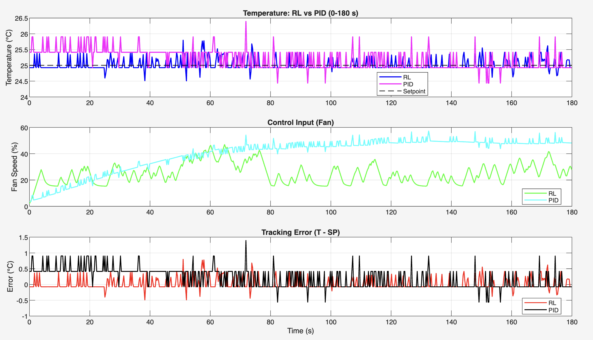

# 🌡️ Projet M2 : Asservissement Thermique par Reinforcement Learning (RL) & Correcteur PID

Projet majeur de fin d'études en **Master 2 Mécatronique, Énergie et Systèmes Intelligents**.

Ce projet porte sur la conception, la modélisation dynamique et la commande avancée en boucle fermée de la température d'un écoulement d'air dans un tube aéraulique instrumenté. Il met en compétition un **régulateur PID classique** (associé à un prédicteur de Smith pour le temps de retard) et un **agent d'Intelligence Artificielle entraîné par Apprentissage par Renforcement (Reinforcement Learning)**.

---

## 🎯 Description du Banc d'Essai (Maquette Thermique)

Le banc physique expérimental est constitué de :
- **Un conduit aéraulique (tube instrumenté) :** Canalise le flux d'air forcé.
- **Actionneur de chauffage :** Résistance électrique chauffante pilotée en modulation de puissance via relais.
- **Actionneur de refroidissement :** Ventilateur à vitesse variable piloté en PWM via pont en H.
- **Instrumentation thermique multi-points :** 4 capteurs de température analogiques ($T_1$ à $T_4$) répartis le long du conduit pour observer le profil spatial, les gradients et le retard pur de convection.
- **Interface Homme-Machine embarquée :** Microcontrôleur Arduino Mega avec écran **LCD 20x4 I2C** et **clavier matriciel 4x3** (sélection des modes Manuel / Automatique, réglage de consigne temps réel, affichage des mesures).

---

## 🔬 Modélisation Dynamique (MATLAB / Simulink)

1. **Modèle électro-thermique équivalent (Réseau RC) :**
   - Modélisation de l'inertie thermique par des capacités ($C_{th}$) et des échanges par conduction/convection par des résistances ($R_{th}$).
   - Prise en compte de la résistance thermique variable de convection $R_v(u_{fan})$ en fonction de la vitesse du ventilateur.
2. **Compensation du retard pur (Transport Delay) :**
   - La propagation de l'air chaud engendre un temps mort (retard pur) entre la source et les capteurs.
   - Intégration et simulation d'un **Prédicteur de Smith** pour compenser le déphasage sur la boucle de retour PID.

---

## 🧠 Approche par Intelligence Artificielle : Reinforcement Learning (RL)

Pour s'affranchir des limitations d'un correcteur linéaire PID face aux non-linéarités thermiques et aux perturbations :
- **Environnement Simulink dédié :** Fichier [`simulink_matlab/Rl_toy.slx`](./simulink_matlab/Rl_toy.slx) interfacé via l'API MATLAB Reinforcement Learning Toolbox ([`simulink_matlab/thermal_rl_env.m`](./simulink_matlab/thermal_rl_env.m)).
- **Observation :** Erreur d'asservissement en température $e_T(t) = T_{consigne} - T_{mesure}$.
- **Action :** Commande continue bornée du ventilateur $u_{fan} \in [0, 1]$ échantillonnée à $T_s = 0.5\text{ s}$.
- **Fonction de récompense (Reward) :** Pénalise quadratiquement l'écart de température et l'amplitude de commande pour inciter à la sobriété énergétique.
- **Agent entraîné :** Modèle pré-entraîné sauvegardé dans [`simulink_matlab/agent_thermal_RL.mat`](./simulink_matlab/agent_thermal_RL.mat).

---

## 📊 Résultats Expérimentaux & Benchmark Comparatif (RL vs PID)

Les essais comparatifs menés sur banc réel pour une consigne de $25.00^\circ\text{C}$ mettent en évidence la supériorité nette de l'agent RL :

### Tableau des Performances Quantitatives

| Métrique de Performance | Régulateur PID Classique | Agent Reinforcement Learning (RL) | Gain / Amélioration |
| :--- | :---: | :---: | :---: |
| **Erreur quadratique moyenne (RMSE)** | $0.361^\circ\text{C}$ | **$0.180^\circ\text{C}$** | **Erreur divisée par 2 (-50%)** |
| **Erreur absolue intégrée (IAE)** | $49.47^\circ\text{C}\cdot\text{s}$ | **$23.81^\circ\text{C}\cdot\text{s}$** | **Amélioration de 52%** |
| **Écart maximal $\|e_{max}\|$** | $1.393^\circ\text{C}$ | **$0.797^\circ\text{C}$** | **Dépassement réduit de 43%** |
| **Effort moyen de commande (PWM)** | $39.9\%$ | **$24.9\%$** | **Consommation réduite de 38%** |
| **Énergie de commande ($\int u^2 dt$)**| $31.57$ | **$12.37$** | **Énergie économisée de 61%** |
| **Temps dans la bande $\pm 0.2^\circ\text{C}$** | $50.5\%$ | **$80.5\%$** | **Précision accrue de +30 points** |
| **Temps dans la bande $\pm 0.5^\circ\text{C}$** | $92.8\%$ | **$98.5\%$** | **Stabilité quasi-parfaite** |

---

## 📈 Description Détaillée des Figures et Graphiques (`results_graphs/`)

Le dossier [`results_graphs/`](./results_graphs/) regroupe l'ensemble des courbes caractéristiques validant la modélisation et les performances :

- **`RL_VS_PID.png` :** Comparatif direct et synchronisé sur 180 secondes entre l'agent RL et le PID. Affiche en 3 sous-graphes : l'évolution de la température par rapport à la consigne, l'effort de commande du ventilateur (PWM %), et le signal d'erreur instantané.
- **`Figure_1.png` :** Réponse temporelle de la température $\theta_1$ calculée par le modèle électro-thermique équivalent (réseau RC) lors d'un échelon de puissance.
- **`Figure_2.png` :** Réponse simulée de la température $\theta_2$, illustrant l'atténuation d'amplitude et le retard induit par la résistance thermique de transfert.
- **`Figure_3.png` :** Caractérisation expérimentale de la résistance de convection thermique $R_v$ en fonction de la vitesse de ventilation.
- **`Figure_4.png` :** Réponse indicielle thermique en boucle ouverte permettant l'identification des constantes de temps et du temps mort de transport du conduit.
- **`Figure_5.png` :** Validation du modèle dynamique simulé par superposition directe avec les mesures réelles issues des capteurs physiques.
- **`test_PID_T3.png` & `test_PID_T4.png` :** Essais d'asservissement en boucle fermée avec le régulateur PID standard sur les capteurs $T_3$ et $T_4$ (dépassement initial notable avant stabilisation).
- **`test_RL_T3.png` & `test_RL_T4.png` :** Essais d'asservissement en boucle fermée avec l'agent Reinforcement Learning sur $T_3$ et $T_4$, montrant une montée rapide sans dépassement critique et une stabilisation très serrée autour de la consigne.

---

## 📂 Contenu du Répertoire

- **`docs/` :**
  - `Rapport_M2_Asservissement_Thermique_IA.pdf` : Rapport officiel de fin d'études M2 (48 pages) complet et illustré.
- **`simulink_matlab/` :**
  - `Rl_toy.slx` & `model_file_sim.slx` : Modèles de simulation Simulink.
  - `thermal_rl_env.m` : Définition de l'environnement Gym/Simulink pour le Reinforcement Learning.
  - `agent_thermal_RL.mat` : Poids du réseau de neurones de l'agent RL entraîné.
  - `RL_VS_PID.m` & `compute_and_save_comparison.m` : Scripts d'analyse et calcul des métriques de benchmark.
  - `comparison_RL_vs_PID_metrics.csv` & `comparison_simple_summary.txt` : Résultats numériques bruts.
  - `results_RL.mat` & `results_PID.mat` : Logs expérimentaux des essais.
- **`firmware_arduino/` :**
  - `asservissement_thermique.ino` : Code embarqué Arduino Mega (boucle de régulation temps réel, filtrage des 4 capteurs LM35, pont en H, LCD 20x4 et clavier 4x3).
  - `sketch_oct21a.ino` : Script d'étalonnage et tests unitaires.
- **`results_graphs/` :**
  - Courbes comparatives `RL_VS_PID.png`, figures d'identification `Figure_1.png` à `Figure_5.png`, et réponses dynamiques `test_RL_*.png` / `test_PID_*.png`.

---

## 🚀 Reproduction des Résultats

1. **Simulation & Analyse RL :**
   - Ouvrir MATLAB et se positionner dans le dossier `simulink_matlab/`.
   - Exécuter le script `RL_VS_PID.m` pour générer automatiquement le graphique comparatif des performances.
2. **Déploiement Embarqué :**
   - Ouvrir `firmware_arduino/asservissement_thermique.ino` dans l'IDE Arduino.
   - Téléverser sur la carte Arduino Mega connectée au banc thermique.
