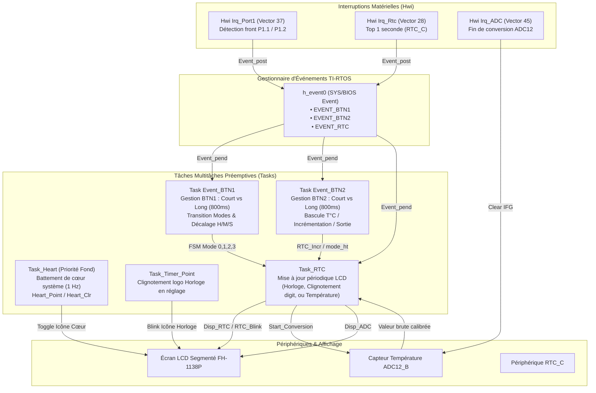

# Système Embarqué Temps Réel (TI-RTOS / SYS/BIOS) – Horloge Multifonction & Thermomètre Numérique

Projet de conception et de programmation temps réel sur microcontrôleur **Texas Instruments MSP430FR6989 LaunchPad** utilisant le noyau temps réel multitâche préemptif **TI-RTOS (SYS/BIOS)**.

Le système implémente une horloge temps réel intelligente avec gestion fine d'interface utilisateur (boutons à double détection court/long, menus FSM), acquisition analogique de température via ADC 12 bits et pilotage dynamique d'un écran LCD segmenté à ultra-basse consommation.

---

## 🛠️ Spécifications & Matériel Cible

| Caractéristique | Description technique |
| :--- | :--- |
| **Microcontrôleur** | Texas Instruments **MSP430FR6989** (Architecture 16-bit RISC ultra-low-power, 16 MHz) |
| **Mémoire** | 128 Ko de mémoire non-volatile FRAM (*Ferroelectric RAM*) haute endurance + 2 Ko SRAM |
| **Système Temps Réel** | **TI-RTOS Kernel (SYS/BIOS v6)** préemptif avec ordonnancement basé sur les priorités |
| **Afficheur** | Contrôleur LCD segmenté intégré pilotant l'écran **FH-1138P** (6 digits alphanumériques + symboles) |
| **Acquisition** | Module **ADC12_B** (convertisseur 12 bits) couplé au capteur de température interne silicium et à la référence de tension `REF_A` (1.2V calibrée) |
| **Base de Temps** | Module périphérique **RTC_C** (*Real-Time Clock*) avec interruption matérielle périodique 1 Hz |
| **Entrées / Sorties** | 2 boutons poussoirs configurés en interruption avec pull-up (`P1.1` BTN1, `P1.2` BTN2), 2 LEDs (`P1.0` Rouge, `P9.7` Verte) |
| **IDE & Chaîne de build** | **Texas Instruments Code Composer Studio (CCS)**, compilateur TI MSP430 v18+, XDCtools |

---

## 🏛️ Architecture Logicielle Temps Réel

Le système s'articule autour d'une architecture événementielle multitâche pilotée par le noyau **SYS/BIOS** :



---

## 📋 Matrice de Validation du Cahier des Charges

Le projet répond point par point aux spécifications fonctionnelles du système RTOS :

| N° | Spécification fonctionnelle | Implémentation logicielle | Statut |
| :---: | :--- | :--- | :---: |
| **1** | **Au démarrage : affichage de l'heure et icône chronomètre** | `init_rtc()` initialise le calendrier à une date par défaut et lance le comptage. `Init_LCD()` et `Timer_Point()` allument le symbole chronomètre dès la phase d'initialisation matérielle. | **Validé** |
| **2** | **Clignotement du logo cœur de 1s (visualisation fonctionnement)** | La tâche dédiée `Task_Heart` boucle indéfiniment en appelant alternativement `Heart_Point()`, `Task_sleep(1000)`, `Heart_Clr()`, et `Task_sleep(1000)`. Ce battement est totalement non-bloquant pour le reste de l'OS. | **Validé** |
| **3** | **Mode Normal : Action longue sur BTN1 $\rightarrow$ Mode réglage + clignotement logo Horloge** | `Event_BTN1` utilise la routine non-bloquante `IsLongPress(BOUTON1, LONG_PRESS_MS)` (800 ms). En cas d'appui long en mode normal (`mode == 0`), le système bascule en mode réglage (`mode = 1`). La tâche `Task_Timer_Point` prend alors le relais pour faire clignoter le logo Horloge (`Clock_ON()` / `Clock_OFF()` toutes les secondes). | **Validé** |
| **4** | **Mode Normal : Action courte sur BTN2 $\rightarrow$ Bascule Heure / Température** | En mode normal, un appui court sur BTN2 commute le drapeau `mode_ht` ($0 \leftrightarrow 1$). À la seconde suivante, `Task_RTC` commute entre `Disp_RTC()` (HH:MM:SS) et `Start_Conversion()` / `Disp_ADC()` (affichage de la température en °C avec virgule). | **Validé** |
| **5** | **Mode Réglage : Action courte sur BTN1 $\rightarrow$ Décalage du clignotement H $\rightarrow$ M $\rightarrow$ S** | Dans `Event_BTN1`, chaque appui court fait cycler la machine à états : `mode = 1` (Heures) $\rightarrow$ `mode = 2` (Minutes) $\rightarrow$ `mode = 3` (Secondes) $\rightarrow$ retour à `mode = 1`. `RTC_Blink(sel)` assure l'extinction périodique alternée des 2 digits cibles. | **Validé** |
| **6** | **Mode Réglage : Action courte sur BTN2 $\rightarrow$ Modification H, M ou S** | Dans `Event_BTN2`, l'appui court appelle `RTC_Incr(sel)` : incrémentation unitaire avec gestion des modulos (0-23 pour les heures, 0-59 pour les minutes et secondes), mise à jour du registre `Calendar` du RTC matériel et rafraîchissement immédiat de l'affichage. | **Validé** |
| **7** | **Mode Réglage : Action longue sur BTN2 $\rightarrow$ Sortie du mode réglage** | L'appui long de 800 ms sur BTN2 détecté par `IsLongPress(BOUTON2, LONG_PRESS_MS)` réinitialise `mode = 0`, ramenant le système en affichage normal de l'horloge et éteignant le clignotement du logo horloge. | **Validé** |

---

## 🗂️ Structure du Projet

```text
07-M2-Systemes-Embarques-TI-RTOS-MSP430/
├── docs/
│   ├── RTOS.jpg                                # Cahier des charges et spécifications fonctionnelles RTOS
│   ├── MSP-EXP430FR6989_EagleCAD_Schematic.pdf # Schéma électronique complet de la carte
│   ├── ADC12.JPG                               # Synoptique matériel de l'ADC12_B
│   └── OverView_CPU.JPG                        # Architecture interne du MSP430FR6989
├── hardware_configs/
│   ├── .project, .cproject, .ccsproject        # Métadonnées du projet Code Composer Studio (CCS)
│   └── targetConfigs/                          # Configuration émulateur JTAG/eZ-FET MSP430
├── rtos_config/
│   └── MSP430_RTOS.cfg                         # Fichier de configuration déclaratif SYS/BIOS (XDCtools)
├── src/
│   ├── main.c / main.h                         # Point d'entrée, initialisations GPIO, tâches BTN & Heart
│   ├── horloge.c / horloge.h                   # Pilote RTC_C, affichage HH:MM:SS, clignotement et incrément
│   ├── degre.c / degre.h                       # Acquisition ADC12, calcul étalonné et affichage T°C
│   ├── hal_LCD.c / hal_LCD.h                   # Abstraction matérielle de l'afficheur LCD segmenté
│   ├── MSP_EXP430FR6989.cmd                    # Script de placement mémoire du Linker TI
│   └── MSP_EXP430FR6989.h                      # Définitions matérielles de la carte LaunchPad
└── exercises_cours/                            # Travaux pratiques et cours de référence TI-RTOS
    ├── Exemple Event.pdf                       # Guide d'utilisation du module SYS/BIOS Event
    ├── Exemple Interruption.pdf                # Guide des interruptions Hwi sur MSP430
    ├── Exemple_Semaphore.pdf                   # Guide de synchronisation par Sémaphores
    ├── Exemples Clock.pdf                      # Guide des timers logiciels Clock
    ├── Exemples Degre.pdf                      # TP conversion analogique-numérique et capteur thermique
    ├── Exemples de HWI.pdf                     # TP configuration avancée des Hwi
    ├── Exemples de Task.pdf                    # TP création et ordonnancement des Tasks
    └── TPC_* (Task, Semaphore, Mailbox, ...)   # Projets d'exemples sources complets du cours
```

---

## 🔬 Points Techniques Remarquables

### 1. Détection Anti-Rebond et Appui Court / Long Non-Bloquant
Pour discriminer un appui court d'un appui long sans bloquer les autres tâches du système (comme le clignotement du cœur ou le rafraîchissement d'horloge), la fonction `IsLongPress()` effectue un polling cadencé par `Task_sleep(10)` :
```c
static bool IsLongPress(uint16_t pinMask, uint32_t durationMs)
{
    uint32_t t = 0;
    while(GPIO_getInputPinValue(GPIO_PORT_P1, pinMask) == 0)
    {
        Task_sleep(10); // Cède le CPU aux autres tâches de priorité égale ou supérieure
        t += 10;
        if(t >= durationMs)
            return true;
    }
    return false;
}
```

### 2. Étalonnage Précis de la Température Silicium
La lecture de la température ambiante utilise les constantes de calibration d'usine brûlées en mémoire ROM TLV (`CALADC_12V_30` et `CALADC_12V_85C`), garantissant une conversion linéaire exacte au dixième de degré près :
$$\text{DegC} = \frac{(\text{ADC12MEM0} - \text{CAL}_{30}) \times (85 - 30) \times 10}{\text{CAL}_{85} - \text{CAL}_{30}} + 300$$

### 3. Abstraction LCD & Multiplexage 4-MUX
Le contrôleur LCD interne fonctionne en mode **4-MUX** sous très faible consommation (ACLK / 16). L'écriture des digits et des symboles (`Heart_Point`, `Clock_ON`, `ClockColon`, etc.) manipule directement les registres de mémoire d'affichage `LCDMEM[]`, assurant un affichage instantané sans scintillement.

---

## 🚀 Compilation & Débogage

1. Lancer **Texas Instruments Code Composer Studio (CCS)**.
2. Importer le projet : `File` $\rightarrow$ `Import` $\rightarrow$ `CCS Projects` $\rightarrow$ Sélectionner le dossier `hardware_configs/`.
3. Vérifier que les composants **TI-RTOS for MSP4x** et **XDCtools** sont sélectionnés dans les propriétés du projet.
4. Connecter la carte **MSP-EXP430FR6989 LaunchPad** via le câble USB micro-B (émulateur eZ-FET embarqué).
5. Cliquer sur l'icône **Debug** (`F11`) pour compiler, flasher la mémoire FRAM et exécuter le système.
